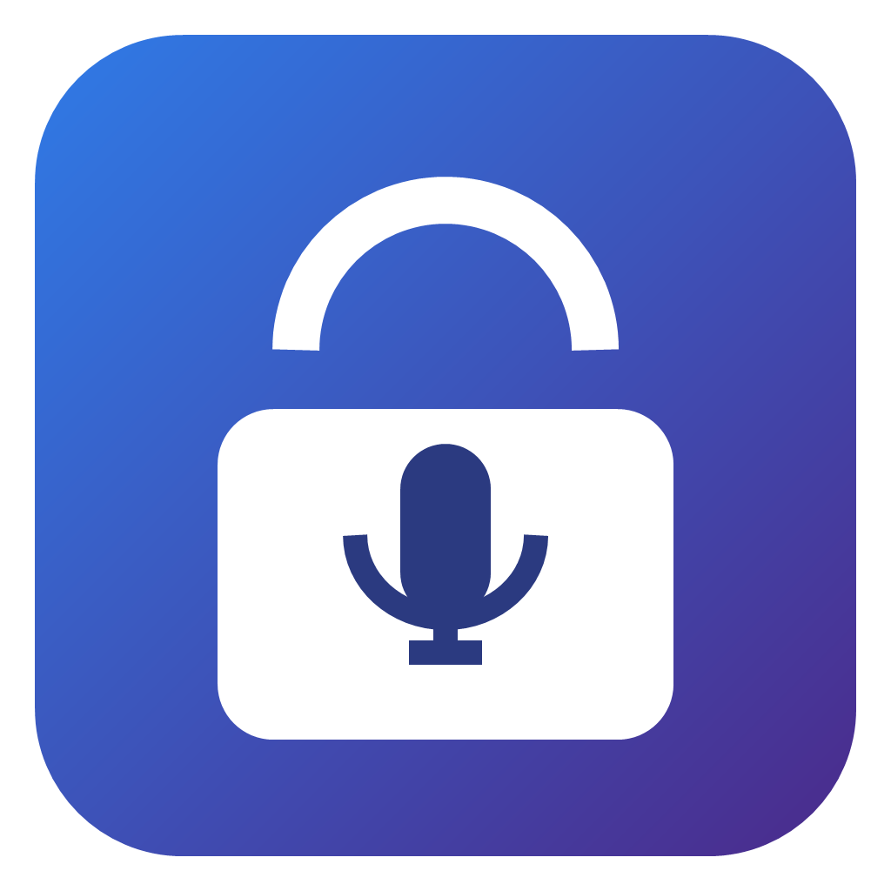
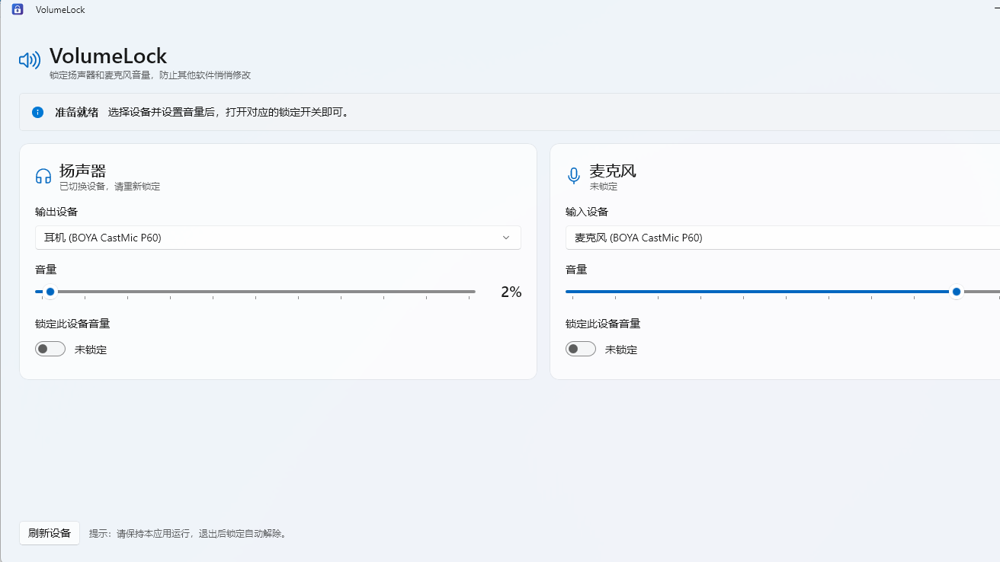

# VolumeLock

VolumeLock 是一个基于 WinUI 3 的 Windows 音量锁定工具，用于固定扬声器和麦克风的系统音量，避免部分软件在后台擅自调整音量。

<p align="center">
  
</p>

<p align="center">
  <a href="https://apps.microsoft.com/detail/9P0GM98HNNQD">Microsoft Store</a> ·
  <a href="PRIVACY.md">隐私声明</a> ·
  <a href="LICENSE">MIT License</a>
</p>

## 下载安装

VolumeLock 已上架 Microsoft Store，可直接下载安装使用，无需自行构建：

<p align="center">
  <a href="https://apps.microsoft.com/detail/9P0GM98HNNQD">
    
  </a>
</p>

商店页面：<https://apps.microsoft.com/detail/9P0GM98HNNQD>

安装后可从开始菜单或搜索中启动 VolumeLock，后续更新由 Microsoft Store 自动推送。

## 界面截图

<p align="center">
  
</p>

## 功能

- 枚举并选择当前启用的扬声器（输出设备）和麦克风（输入设备）
- 读取、设置所选设备的系统主音量
- 分别锁定扬声器和麦克风音量
- 通过 Core Audio 音量变更回调和定时校验，自动恢复被其他程序修改的音量
- 显示已拦截的外部修改次数
- 支持系统托盘：
  - 左键点击托盘图标显示主界面
  - 右键菜单可显示主界面、锁定/解锁扬声器、锁定/解锁麦克风、退出
  - 菜单勾选状态与主界面锁定状态实时同步
  - 任意设备处于锁定状态时显示正常图标，全部解锁时显示灰色解锁图标
  - 托盘提示中显示当前锁定的设备和音量
- 关闭主窗口时隐藏到托盘，应用继续在后台保持锁定
- 单实例运行：重复启动时激活已有窗口
- 跟随系统浅色/深色主题，使用 Mica 背景
- 内置简体中文和英文界面

## 系统要求

运行（从 Microsoft Store 安装）：

- Windows 10 版本 1809（build 17763）或更高版本
- **无需预装 .NET 运行时**：安装包已内置 .NET 11 运行时（自包含 + 裁剪），开箱即可启动。

从源码构建本项目还需要：

- .NET 11 SDK
- 首次还原 NuGet 包时需要网络连接
- 推荐使用 Visual Studio 2022 或更高版本，并安装“Windows 应用开发”相关负载

## 从源码构建

> 仅在你需要自行编译或修改代码时需要本节内容；普通用户请直接从 [Microsoft Store](https://apps.microsoft.com/detail/9P0GM98HNNQD) 安装。

在项目根目录执行：

```powershell
dotnet restore VolumeLock.csproj
dotnet build VolumeLock.csproj -c Debug -p:Platform=x64
```

也可以使用 Visual Studio 打开 `VolumeLock.slnx`，选择 `x64` 平台后生成。

项目支持以下平台：

- `x64`
- `ARM64`

## 从源码运行

```powershell
dotnet run --project VolumeLock.csproj -p:Platform=x64
```

如果使用 Visual Studio，直接按 `F5` 启动即可。

## 图标资源

所有磁贴、启动画面、商店徽标和托盘图标都由品牌母版 [`Assets/AppIcon.png`](Assets/AppIcon.png) 统一派生，不要手工编辑单个尺寸的文件。修改母版后执行：

```powershell
.\Tools\Generate-Assets.ps1
```

脚本会重新生成 `Assets` 下的全部 59 个资源文件（含多语言缩放变体），并清理本脚本历史版本遗留的过时文件：

| 资源 | 生成的变体 |
| --- | --- |
| `Square44x44Logo` | 默认 + `scale-125/150/200/400` + 14 组 `targetsize-*_altform-unplated/-lightunplated` |
| `Square150x150Logo` | 默认 + `scale-125/150/200/400` |
| `Wide310x150Logo` | 默认 + `scale-125/150/200/400` |
| `SplashScreen` | 默认 + `scale-125/150/200/400` |
| `StoreLogo` | 默认 + `scale-125/150/200/400` |
| `LockScreenLogo` | `scale-100/200/400`（纯白单色，锁屏背景上可见） |
| `AppIcon.ico` / `AppIconUnlocked.ico` | 16/20/24/32/40/48/64/128/256 px 多尺寸 |

注意：

- 磁贴类资源使用不透明渐变底 + 白色锁形，浅色和深色主题下都能看清。
- 启动画面为透明底，背景色由 `Package.appxmanifest` 的 `SplashScreen` `BackgroundColor` 提供。
- ICO 必须保留 16×16 条目，否则托盘图标会被缩放模糊。

## 打包

生成 x64 MSIX：

```powershell
dotnet publish VolumeLock.csproj -c Release `
  -p:Platform=x64 `
  -p:RuntimeIdentifier=win-x64 `
  -p:GenerateAppxPackageOnBuild=true `
  -p:AppxPackageSigningEnabled=false
```

生成 x64 + ARM64 商店捆绑包：

```powershell
.\Build-StoreBundle.ps1
```

脚本会先调用 `Tools\Generate-Assets.ps1` 重建图标资源，然后校验清单引用的图标文件全部存在、ICO 含 16×16 条目，最后产出包含 x64/ARM64 主包与 `scale-100/125/150/400` 资源包的捆绑包。输出目录为 `StorePackages`。

### 部署方式

项目默认以 **自包含 + 裁剪**（`SelfContained=true` + `PublishTrimmed=true`）方式发布：.NET 运行时打进 MSIX，用户机器无需预装 .NET；ILLink 同时裁掉运行时里用不到的部分，把自包含的体积压到和框架依赖相当。

不再提供 **框架依赖** 方式。原因是商店只会根据清单中的 `<PackageDependency>` 自动安装“框架包”，而 .NET 5+ 没有对应的 MSIX 框架包（[dotnet/runtime#51574](https://github.com/dotnet/runtime/issues/51574) 至今未解决），手动添加 `<PackageDependency Name="Microsoft.NETCore.App">` 实测会以 `0x80073CF3`“依赖于找不到的框架”导致**安装失败**。框架依赖包唯一的效果，就是让没装 .NET 的用户在启动时被弹框要求手动下载运行时。

备选方式是自包含但**不裁剪**（打进完整运行时），用于排查裁剪相关问题：

```powershell
.\Build-StoreBundle.ps1 -FullRuntime
```

该开关会传 `-p:FullRuntime=true`，`VolumeLock.csproj` 据此关闭 `PublishTrimmed`，但仍然是自包含。单个 `dotnet publish` 也可以直接加 `-p:FullRuntime=true`。

裁剪只在 `Release` 配置下开启：ILLink 每次都要花上几十秒，并且会输出裁剪分析告警，没必要污染日常 `Debug` 构建。所以本地调试得到的输出仍然是自包含但不裁剪的。

实测体积（Release，含 x64 + ARM64）：

| 发布方式 | 主包（每架构） | 捆绑包（x64 + ARM64） |
| --- | --- | --- |
| 自包含 + 裁剪（默认） | x64 7.82 MB / ARM64 7.86 MB（解包后 17.1 / 18.3 MB） | 16.0 MB |
| 自包含 + 完整运行时（`-FullRuntime`） | x64 44.7 MB / ARM64 43.4 MB | 88.4 MB |

商店按架构分发，单个用户只下载自己架构的那份。

两种方式下 `PublishReadyToRun` 都是关闭的：它们都打包了运行时，对整个框架做 R2R 预编译会让体积再涨约 36 MB，收益不足以抵消。打包目标还会剔除 .NET 的诊断工具链（`createdump.exe`、`mscordaccore*.dll`、`mscordbi.dll`、`Microsoft.DiaSymReader.Native.*.dll`、`clretwrc.dll`、`clrgcexp.dll`，完整运行时下约 7.4 MB）——发布版应用不会用到它们，剔除后已验证应用可正常启动。

Windows App SDK 保持框架依赖（未设置 `WindowsAppSDKSelfContained`），由商店自动安装并随服务更新。

### 关于裁剪（PublishTrimmed）

裁剪是现在的默认发布方式。它本身不再需要额外开关，但**音频 COM 互操作必须改用源生成方式**，否则裁剪版会启动正常、功能全废。

**裁剪会破坏内建 COM 封送。** 传统 `[ComImport]` + `System.__ComObject` 的内建 COM interop 会在运行时生成封送存根，而 ILLink 裁剪后这个生成过程不再可靠：存根会走错 vtable 槽位。实测表现为同一份源码两次构建结果不同——一次 `hr=0`，一次 `0x80004003 E_POINTER`；`Activate` 之后调 `GetChannelCount` / `GetMasterVolumeLevelScalar` 直接 AV 崩溃 `0xC0000005`；`IPropertyStore.GetValue` 返回 `E_INVALIDARG`，`GetFriendlyName` 退化成返回设备 ID。用户看到的就是「扬声器读取失败」。

解法是把 Core Audio 的这些接口全部改成**源生成 COM interop**（`AudioInterop.cs`）：

- `[GeneratedComInterface]` 代替 `[ComImport]`，封送存根在编译期生成，裁剪不会破坏。
- CLSID 激活用的是 `CoCreateInstance` P/Invoke（返回裸指针），因此需要 `ComInterfaceMarshaller<T>.ConvertToManaged((void*)pointer)` 把它转成托管包装（封装在 `AudioInterop.Wrap` 里），这需要 `<AllowUnsafeBlocks>true</AllowUnsafeBlocks>`。接口方法的 `out IDevice` / `out IAudioEndpointVolume` 参数由源生成封送处理，不需要中转指针。
- `ConvertToManaged` 自带一次 `AddRef`，所以 `Wrap` 里会把调用方持有的那份引用 `Marshal.Release` 掉。
- 返回的包装类型是 `ComObject`：**不是 `IDisposable`**，也没有 `FinalReleaseComObject`，靠 GC 终结器释放。
- 回调方向用 `[GeneratedComClass]`：`VolumeChangeCallback` 就是这样一个类。

因为项目里已经没有内建 COM 使用者，`BuiltInComInteropSupport` 保持默认（`false`）。打开它只会多一条 `IL2026` 裁剪告警，没有任何作用——开关打开/关闭各打一次包，启动、读设备、锁定全部正常，实测确认。

**vtable 顺序必须逐个方法写全。** 少写中间任何一个方法，后面的调用就会走错槽位并 AV 崩溃。`IAudioEndpointVolume` 是 13 个方法（`RegisterControlChangeNotify`、`UnregisterControlChangeNotify`、`GetChannelCount`、`SetMasterVolumeLevel`、`SetMasterVolumeLevelScalar`、`GetMasterVolumeLevel`、`GetMasterVolumeLevelScalar`、`SetChannelVolumeLevel`、`SetChannelVolumeLevelScalar`、`GetChannelVolumeLevel`、`GetChannelVolumeLevelScalar`、`SetMute`、`GetMute`），`IPropertyStore` 是 5 个（`GetCount`、`GetAt`、`GetValue`、`SetValue`、`Commit`）。

另有一个坑：ILLink 有增量缓存。改完裁剪相关配置后必须 `Remove-Item obj,bin -Recurse -Force` 再发布，否则 runtimeconfig 看起来是新的，程序集还是旧的裁剪结果，异常照旧。

Windows App SDK 的投影程序集（含 `Microsoft.Windows.ApplicationModel.WindowsAppRuntime.Projection`）在裁剪后能自行保留，**不需要** `TrimmerRootAssembly`。

历史记录：最初裁剪版启动即崩，事件日志显示 `0xC000027B` + 故障模块 `Microsoft.UI.Xaml.dll`，看起来像"WinUI 3 不支持裁剪"。实际是 `Type.GetTypeFromCLSID` 抛 `NotSupportedException`，异常从 XAML 激活 `MainPage` 的路径抛出被包装成 stowed exception。当时靠 `BuiltInComInteropSupport=true` 绕过了启动崩，但 COM 封送仍然是坏的，于是下一层故障变成了「扬声器读取失败」。

**升级 .NET SDK 或 Windows App SDK 后需要重新打包，并实测扬声器/麦克风音量能否读出**（只看窗口能否出来不够）。若出问题，可先用 `-FullRuntime` 发布一份不裁剪的包，判断是否与裁剪有关。

另外两点实测结论：

- `PublishAot=true`（Native AOT）不可行：构建期即报 `PublishTrimmed is implied by native compilation`，另有大量 CsWinRT1033 / WMC1510 不兼容警告。
- 直接双击发布目录里的 `VolumeLock.exe` 运行（松散文件、无包身份）无论裁剪与否都会崩在 `<Module>.cctor` 的 `0x80040154 没有注册类`，因为 `DeploymentManager` 初始化需要包身份。这个项目的启动验证必须走 MSIX 注册，不能靠裸跑 exe。

## 使用说明

1. 从 [Microsoft Store](https://apps.microsoft.com/detail/9P0GM98HNNQD) 安装并启动 VolumeLock。
2. 在“扬声器”或“麦克风”区域选择要控制的设备。
3. 调整音量滑块到目标值。
4. 打开“锁定此设备音量”开关。
5. 保持应用运行。关闭窗口后应用会隐藏到托盘，锁定继续生效。
6. 需要彻底退出时，右键点击托盘图标并选择“退出”。

锁定时仍然可以拖动滑块调整目标音量，锁定值会同步更新。

## 实现原理

VolumeLock 直接调用 Windows Core Audio API：

- 使用 `IMMDeviceEnumerator` 枚举音频终结点
- 使用 `IAudioEndpointVolume` 读取和设置系统主音量
- 通过 `IAudioEndpointVolumeCallback` 监听音量变化
- 外部程序修改音量后立即写回目标值
- 使用每秒执行一次的定时校验作为兜底

托盘功能基于 Win32 `Shell_NotifyIcon`、弹出菜单和隐藏消息窗口实现，不依赖第三方托盘库。

## 项目结构

```text
VolumeLock/
├─ Program.cs                 # 应用入口、单实例与激活重定向
├─ App.xaml / App.xaml.cs     # 应用生命周期、托盘接入、退出清理
├─ MainWindow.xaml(.cs)       # 主窗口、标题栏与主题
├─ MainPage.xaml(.cs)         # 音量设置、锁定状态与交互逻辑
├─ AudioVolumeService.cs      # Core Audio COM 互操作、音量读取/设置/锁定
├─ TrayIconService.cs         # 托盘图标、右键菜单与图标状态切换
├─ ThemeService.cs            # 跟随系统浅色/深色主题
├─ LocalizationService.cs     # 资源字符串读取
├─ Strings/                   # en-US、zh-CN 本地化资源
├─ Assets/                    # 应用图标、托盘图标和商店素材
├─ Tools/Generate-Assets.ps1  # 从品牌母版派生全部图标资源
├─ Package.appxmanifest       # MSIX 应用清单
└─ Build-StoreBundle.ps1      # 生成 x64 + ARM64 商店捆绑包
```

## 已知限制

- 锁定的是所选音频设备的系统主音量，不控制单个应用的独立音量。
- 锁定仅在 VolumeLock 运行期间有效，退出应用后会自动解除。
- 部分虚拟音频设备可能不提供标准音量控制接口。
- 本工具通过系统音量回调和定时校验实现恢复，不是驱动级强制保护。

## 隐私

VolumeLock 不需要账号，不包含广告、分析、遥测或追踪，不读取、录制、保存或上传任何音频内容，也不会向服务器发送数据。

详细说明见 [PRIVACY.md](PRIVACY.md)。

## 许可证

本项目使用 [MIT License](LICENSE)。
